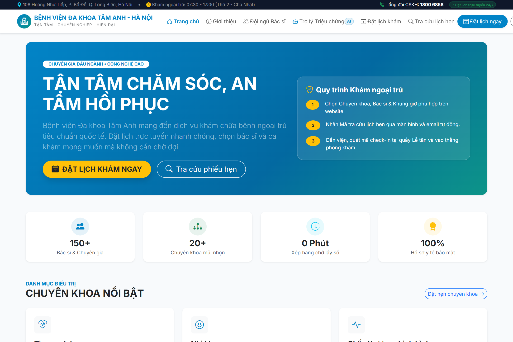
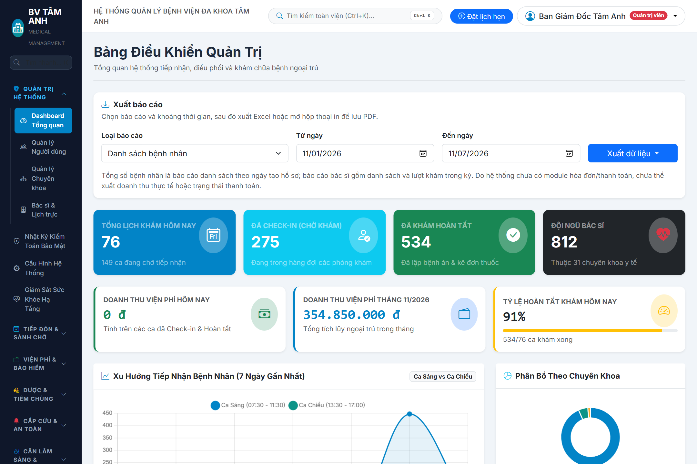
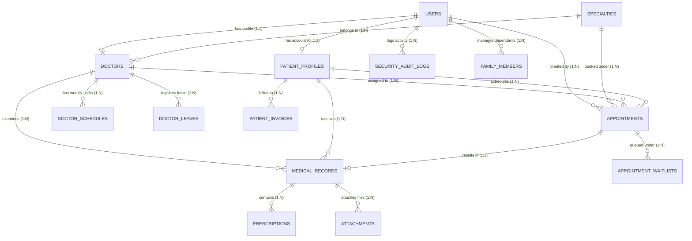

# HỆ THỐNG QUẢN LÝ BỆNH VIỆN ĐA KHOA TÂM ANH
### TAM ANH SMART HOSPITAL MANAGEMENT SYSTEM (HIS & EMR)

> **Đồ án môn học:** Phát triển ứng dụng Web (PHP - Laravel - MySQL)  
> **Kho lưu trữ mã nguồn chính thức (Repository):** [https://github.com/quy0358/He-Thong-Quan-Ly-Benh-Vien-Tam-Anh](https://github.com/quy0358/He-Thong-Quan-Ly-Benh-Vien-Tam-Anh)  
> **Tài liệu Kế hoạch Triển khai & Kiến trúc Chi tiết:** [`ke_hoach_trien_khai_benh_vien_tam_anh.md`](./ke_hoach_trien_khai_benh_vien_tam_anh.md)  
> **Tài liệu Đặc tả Nghiệp vụ & Chuẩn Y khoa Toàn diện:** [`docs/TAILIEU_NGHIEP_VU_VA_KIEN_TRUC_Y_TE.md`](./docs/TAILIEU_NGHIEP_VU_VA_KIEN_TRUC_Y_TE.md)

---

## GIAO DIỆN HỆ THỐNG THỰC TẾ (SYSTEM SHOWCASE)

| Cổng Thông Tin Y Tế Công Khai & Đặt Lịch Khám | Trung Tâm Quản Trị Bệnh Viện & Y Khoa Toàn Diện |
| :---: | :---: |
|  |  |
| *Giao diện Trang chủ hiện đại, tìm kiếm bác sĩ AJAX, AI gợi ý triệu chứng & Đặt lịch thông minh* | *Bảng điều khiển quản trị trung tâm, KPI thời gian thực, biểu đồ Chart.js & Quản trị y khoa toàn diện* |

---

## MỤC LỤC ĐIỀU HƯỚNG NHANH

1. [Danh Sách Thành Viên Nhóm & Phân Công Vai Trò](#1-danh-sách-thành-viên-nhóm-và-phân-công-vai-trò)
2. [Contributors (Danh Sách Thành Viên Đóng Góp & Pull Requests)](#2-contributors-danh-sách-thành-viên-đóng-góp)
3. [Công Nghệ & Môi Trường Phát Triển](#3-công-nghệ-và-môi-trường-phát-triển)
4. [Sơ Đồ Cơ Sở Dữ Liệu (ERD)](#4-sơ-đồ-cơ-sở-dữ-liệu-erd)
5. [Bảng Phân Công Nhiệm Vụ Chi Tiết Từng Thành Viên](#5-bảng-phân-công-nhiệm-vụ-chi-tiết-từng-thành-viên)
   - [Nguyễn Thành Quý - Technical Lead & System Core Architect](#1-nguyễn-thành-quý-technical-lead--system-core-architect)
   - [Nguyễn Văn Đạt - Master Data, Public Portal & Medical Governance](#2-nguyễn-văn-đạt-master-data-public-portal--medical-governance)
   - [Nguyễn Văn Hưng - Patient Reception, Inpatient & Clinical Safety](#3-nguyễn-văn-hưng-patient-reception-inpatient--clinical-safety)
   - [Võ Lê Gia Bảo - Consultation, Records & Analytics](#4-võ-lê-gia-bảo-consultation-records--analytics)
6. [Bộ 10 Phân Hệ Kiến Trúc & An Ninh Đột Phá (Technical Lead)](#6-bộ-10-tính-năng-kiến-trúc--an-ninh-nâng-cao-technical-lead)
7. [Quy Trình Phối Hợp Git Của Nhóm (Git Workflow)](#7-quy-trình-phối-hợp-git-của-nhóm-git-workflow)
8. [Hướng Dẫn Cài Đặt Dự Án Trên Máy Windows (XAMPP)](#8-hướng-dẫn-cài-đặt-dự-án-trên-máy-windows-xampp)
9. [Tài Khoản Mẫu Dùng Để Kiểm Thử & Trình Diễn (Seed Data)](#9-tài-khoản-mẫu-dùng-để-kiểm-thử-và-trình-diễn-seed-data)
10. [Báo Cáo Kiểm Thử Tự Động Toàn Viện (Automated Testing Report)](#10-báo-cáo-kiểm-thử-tự-động-toàn-viện-automated-testing-report)
11. [Tiến Độ Thực Hiện 4 Tuần](#11-tiến-độ-thực-hiện-4-tuần)

---

## 1. DANH SÁCH THÀNH VIÊN NHÓM VÀ PHÂN CÔNG VAI TRÒ

| STT | Họ và tên | Mã số SV | Vai trò chính | Trách nhiệm trọng tâm |
| :---: | :--- | :---: | :--- | :--- |
| **1** | **Nguyễn Thành Quý** | *Tech Lead* | **Technical Lead & System Core Architect** | Kiến trúc hệ thống Laravel 11, Master Layouts & UI Components, Auth & RBAC Middleware, Engine Đặt lịch khám đa tầng (Pessimistic Row Locking), Email tự động & Bộ 10 Phân hệ Kiến trúc/An ninh đột phá (2FA TOTP, Waitlist FIFO, Remote Session Invalidation, Anti-Spam Bot, System Health Telemetry). |
| **2** | **Nguyễn Văn Đạt** | *Member* | **Master Data, Public Portal & Medical Governance** | Quản lý Chuyên khoa (CRUD), Hồ sơ Bác sĩ, Phân ca trực tuần, Cổng thông tin Bác sĩ công khai, Upload Avatar, AJAX Live Search tức thì (Debounce 350ms, pushState), Trợ lý AI gợi ý chuyên khoa theo triệu chứng, Danh thiếp số vCard RFC 6350, Thẻ để bàn Mica phòng khám & Mẫu in CV PDF A4, CCHN/CME Hub, Cùng **Hệ sinh thái Quản trị Y khoa Toàn diện (Medical Governance)**: 970 phẫu thuật TT50/BYT, 730 phác đồ CPG, 840 ca CME, 500 NCKH & Cân bằng mệt mỏi Fatigue Index. |
| **3** | **Nguyễn Văn Hưng** | *Member* | **Patient Reception, Inpatient & Clinical Safety** | Quản lý Hồ sơ người bệnh (`patient_profiles`), Bàn tiếp nhận & Kiosk sảnh tự phục vụ quét CCCD/BHYT, In số thứ tự nhiệt 80mm, Viện phí thông minh VietQR Napas247, Quầy dược ngoại trú FEFO, Cảnh báo tương tác thuốc & dị ứng chéo, Phân luồng Cấp cứu Triage ATS 5 cấp, Báo động đỏ Code Red, NEWS2 & Đội phản ứng nhanh RRT, An toàn truyền máu đối chiếu kép ABO/Rh tại giường & Universal Spotlight Search toàn viện (`Ctrl + K`). |
| **4** | **Võ Lê Gia Bảo** | *Member* | **Consultation, Records & Analytics** | Màn hình hàng đợi khám của Bác sĩ trong ca (`DoctorQueueController`), Lập bệnh án điện tử EMR, Kê đơn thuốc lặp trong Database Transaction, Upload/Download tệp tin y tế bảo mật qua Policy Authorization (`AttachmentPolicy`), Dashboard Quản trị viên trung tâm, Bộ xuất Báo cáo thống kê Excel/PDF thông minh (`XlsxReportWriter`) & Cổng thông tin Bệnh nhân. |

---

## 2. CONTRIBUTORS (DANH SÁCH THÀNH VIÊN ĐÓNG GÓP)

Toàn bộ các phân hệ chức năng được phát triển độc lập theo nhánh tính năng và tích hợp liên tục vào mã nguồn chính thông qua **13 Pull Requests** chuẩn mực:

| Thành viên | GitHub Username | Vai trò & Đóng góp chính | Trạng thái tích hợp | Kết quả kiểm thử |
| :--- | :---: | :--- | :---: | :---: |
| **Nguyễn Thành Quý** | [@quy0358](https://github.com/quy0358) | **Technical Lead & Core Architect**: Kiến trúc nền tảng Laravel 11, Master Layouts, Auth & RBAC, Booking Engine, Cùng **Bộ 10 Tính Năng Đột Phá Kiến Trúc & An Ninh Nâng Cao** (2FA TOTP RFC 6238, Smart Waitlist FIFO, Calendar Sync RFC 5545, Family Health Profiles, Reschedule Engine, Anti-Spam Bot, Security Audit CSV, Active Device Sessions, Dynamic Settings, Telemetry Health). | []() | []() |
| **Nguyễn Văn Đạt** | [@jtadd123](https://github.com/jtadd123) | **Master Data, Public Portal & Medical Governance**: Quản trị Chuyên khoa & Bác sĩ, Lịch trực tuần, AI Symptom Matcher, vCard QR, Wayfinding, Song ngữ EN/VI, Reviews, KPI, Workload Balancer, CCHN, Cùng **Hệ sinh thái Quản trị Y khoa Toàn diện** (970 phẫu thuật TT50, 730 phác đồ CPG, 840 ca CME, 500 NCKH & Fatigue Balancer). | []() | []() |
| **Nguyễn Văn Hưng** | [@hung090725](https://github.com/hung090725) | **Patient Reception, Inpatient & Clinical Safety**: Quản lý hồ sơ người bệnh, tiếp đón sảnh, Kiosk tự phục vụ, viện phí VietQR, an toàn dược & lâm sàng, Spotlight Search toàn viện (`Ctrl + K`) và 27+ phân hệ chuyên sâu theo tiêu chuẩn Bộ Y tế & JCI Quốc tế. | []() | []() |
| **Võ Lê Gia Bảo** | [@gbao289](https://github.com/gbao289) | **Consultation, Records & Analytics**: Bàn khám bác sĩ, Hàng đợi ca khám, Bệnh án điện tử EMR, Đơn thuốc lặp trong Database Transaction, File y tế bảo mật qua Policy, Dashboard thống kê, Xuất báo cáo Excel/PDF (`XlsxReportWriter`) & Cổng thông tin Bệnh nhân. | []() | []() |

---

## 3. CÔNG NGHỆ VÀ MÔI TRƯỜNG PHÁT TRIỂN

- **Ngôn ngữ lập trình & Phiên bản:** PHP 8.2+ (chạy qua XAMPP hoặc PHP CLI standalone).
- **Framework phía máy chủ (Backend):** Laravel 11.x (cấu trúc thư mục tối ưu, Service Layer, Policy Authorization, Database Transactions, Mailables, Eloquent ORM).
- **Cơ sở dữ liệu (Database):** MySQL 8.0 / MariaDB (InnoDB Engine, UTF8MB4, Foreign Key Constraints, Pessimistic Row Locking `lockForUpdate()`).
- **Giao diện người dùng (Frontend):** 
  - Laravel Blade Template Engine kết hợp Master Layouts kế thừa linh hoạt.
  - Bootstrap 5.3 (CSS & JS Bundle) + Bootstrap Icons.
  - Hệ thống Toast Notification góc phải màn hình chuẩn UX hiện đại.
  - Biểu đồ dữ liệu trực quan: **Chart.js** (Bar chart & Doughnut chart).
  - Tìm kiếm AJAX Live Search tức thì (Debounce 350ms, Loading Spinner, đồng bộ URL `pushState`).
- **Bảo mật & Quản lý Phiên:**
  - Xác thực 2 bước 2FA TOTP RFC 6238 thuần PHP, tương thích Google/Microsoft Authenticator.
  - Laravel Session Driver, CSRF Token Protection, Bcrypt Password Hashing, Form Requests Validation.
  - Bẫy bot vô hình (Invisible Honeypot) kết hợp Velocity Check (> 1.5s) & Rate Limiting IP.
  - Vô hiệu hóa phiên đăng nhập từ xa (Remote Session Invalidation).
- **Lưu trữ Tệp tin Y tế:** Laravel Local Storage phân vùng riêng tư (`storage/app/private/medical_records`), kiểm duyệt quyền truy cập thông qua `AttachmentPolicy` (chặn rò rỉ HTTP 403).
- **Kiểm thử tự động (Automated Testing):** PHPUnit 10 với bộ kịch bản Feature Test & Unit Test toàn diện.

---

## 4. SƠ ĐỒ CƠ SỞ DỮ LIỆU (ERD)



### Danh mục Bảng Dữ Liệu Cốt Lõi:
1. `users`: Quản lý danh tính đăng nhập, mật khẩu mã hóa Bcrypt, vai trò RBAC (`admin`, `receptionist`, `doctor`, `patient`), Secret Key 2FA TOTP và Recovery Codes.
2. `specialties`: Danh mục chuyên khoa lâm sàng (Tim mạch, Nhi khoa, Cơ xương khớp,...), slug SEO, trạng thái hoạt động và cờ trực cấp cứu (Emergency Readiness).
3. `doctors`: Hồ sơ bác sĩ (liên kết 1-1 với `users`), học hàm TS.BS/ThS.BS/BSCKII, phòng khám, giá khám niêm yết, tiểu sử y khoa, trạng thái sẵn sàng tiếp nhận bệnh.
4. `doctor_schedules`: Lịch làm việc định kỳ trong tuần (Thứ 2 đến Chủ nhật) chia 2 ca Sáng/Chiều và định ngạch số lượng tiếp nhận (`max_patients`).
5. `doctor_leaves`: Đăng ký nghỉ phép, hội thảo y khoa, phân công bác sĩ tiếp nhận trực thay.
6. `patient_profiles`: Hồ sơ hành chính bệnh nhân, số điện thoại, CCCD/BHYT, địa chỉ, mã số `patient_code` duy nhất.
7. `appointments`: Lịch khám bệnh, mã số hẹn duy nhất, ngày khám, ca khám, trạng thái (`pending`, `confirmed`, `completed`, `cancelled`).
8. `appointment_waitlists`: Danh sách chờ thông minh FIFO, tự động đôn người khi có ca hủy.
9. `medical_records`: Hồ sơ bệnh án điện tử EMR, triệu chứng lâm sàng, chẩn đoán xác định, lời dặn bác sĩ.
10. `prescriptions`: Chi tiết đơn thuốc điều trị (tên thuốc, hàm lượng, số lượng, liều dùng, đường dùng).
11. `attachments`: Quản lý tệp xét nghiệm, X-quang, chẩn đoán hình ảnh bảo mật với phân quyền tải an toàn.
12. `patient_invoices`: Hóa đơn viện phí điện tử, mã VietQR Napas247, trạng thái thanh toán và đồng chi trả BHYT.
13. `security_audit_logs`: Nhật ký kiểm toán bảo mật, lưu vết đăng nhập, đổi mật khẩu, xuất dữ liệu và cảnh báo Brute-Force.
14. `system_settings`: Bảng cấu hình tham số động hệ thống thời gian thực (tên bệnh viện, hotline, chế độ bảo trì đặt lịch).

---

## 5. BẢNG PHÂN CÔNG NHIỆM VỤ CHI TIẾT TỪNG THÀNH VIÊN

---

### 1. NGUYỄN THÀNH QUÝ (Technical Lead & System Core Architect)
- **Chi nhánh phát triển:** `feature/auth-and-booking`
- **Phạm vi phụ trách cốt lõi:**
  - Khởi tạo kiến trúc nền tảng Laravel 11, Master Layouts (`layouts/master.blade.php`, `layouts/admin.blade.php`), Components tái sử dụng (`<x-alert>`, `<x-status-badge>`).
  - Hệ thống Xác thực (Auth) & Phân quyền (RBAC): Đăng nhập, đăng xuất, đổi mật khẩu, Remember Me, Middleware `CheckRole` kiểm soát chặt chẽ 4 vai trò.
  - Thiết kế Migration & Seeder nền tảng: `users`, `appointments`, `security_audit_logs`, `system_settings`, `family_members`.
  - Xây dựng **Booking Engine Đa Tầng**:
    - Giao diện đặt lịch khám trực tuyến thân thiện, lọc bác sĩ theo chuyên khoa qua AJAX.
    - Áp dụng kỹ thuật **Pessimistic Row Locking (`lockForUpdate`)** ngăn chặn hoàn toàn hiện tượng race condition và overbooking khi nhiều người cùng đặt 1 ca khám.
    - Kiểm tra và chặn trùng ca khám cùng bác sĩ trong một khung giờ.
  - Tự động gửi Email xác nhận đặt lịch khám `AppointmentCreatedMail` & `AppointmentRescheduledMail`.
  - Xây dựng Cổng thông tin Bệnh nhân (Patient Portal): Tra cứu mã lịch hẹn, lịch sử khám bệnh cá nhân.
- **Bộ 10 Phân Hệ Kiến Trúc & An Ninh Đột Phá:**
  1. **Xác thực 2 bước 2FA (RFC 6238 TOTP):** Tự viết engine RFC 6238 HMAC-SHA1 trong PHP thuần, bộ mã hóa Base32, cấp 8 mã khôi phục dự phòng một lần, tương thích Google/Microsoft Authenticator.
  2. **Quản lý Phiên & Đăng xuất Thiết bị Từ xa:** Giám sát IP, User-Agent, thời gian hoạt động; cho phép người dùng vô hiệu hóa phiên thiết bị khác từ xa bằng mật khẩu.
  3. **Nhật ký Kiểm toán Bảo mật & Phát hiện Brute-Force:** Ghi nhận mọi sự kiện an ninh, tự động nhận diện mẫu tấn công dò mật khẩu liên tục và gắn cờ `brute_force_alert`, hỗ trợ xuất báo cáo CSV chuẩn UTF-8 BOM.
  4. **Hàng Đợi Chờ Thông Minh (Smart Waitlist Engine):** Thuật toán xếp hàng chờ FIFO khi ca khám đạt ngưỡng `max_patients`. Khi có người hủy khám, hệ thống tự động đôn người chờ (Auto-Promotion) và gửi email thông báo xác nhận.
  5. **Đồng bộ Lịch khám Cá nhân (Calendar Sync):** Tạo đường dẫn thêm vào Google Calendar trực tiếp và xuất tệp iCalendar chuẩn quốc tế RFC 5545 (`.ics`) cho Apple Calendar, Outlook.
  6. **Hồ sơ Người thân & Đặt lịch Gia đình:** Quản lý thông tin người phụ thuộc (con cái, cha mẹ, người già), tự động điền nhanh khi đặt lịch khám.
  7. **Đổi Lịch Khám Tự Phục Vụ (Self-Service Reschedule):** Bệnh nhân tự đổi ngày/ca khám trực tuyến, kiểm tra định ngạch ca mới và tự động kích hoạt đôn người cho slot cũ vừa giải phóng.
  8. **Bộ Lọc Chống Spam Bot Đa Tầng:** Cơ chế bẫy bot tàng hình (Invisible Honeypot) + Kiểm tra thời gian thao tác (Velocity Check > 1.5s) + Rate Limiter IP (15 request / 5 phút).
  9. **Cấu Hình Tham Số Động & Chế Độ Bảo Trì:** Quản lý tham số hệ thống bệnh viện thời gian thực qua Cache; công tắc bật/tắt bảo trì cổng đặt lịch trả về HTTP 503 thân thiện.
  10. **Giám Sát Sức Khỏe Hạ Tầng Toàn Diện (System Health Telemetry):** Bảng đo đạc vi mô thời gian thực: Độ trễ MySQL/MariaDB (ms), dung lượng ổ cứng, quyền ghi Storage, Cache read/write, Ping máy chủ Email, theo dõi RAM usage.
- **Kết quả kiểm thử:** Toàn bộ 10 phân hệ hoạt động hoàn hảo, **11/11 automated tests trong `TechLeadInnovationSuiteTest` đạt 100% Green (68 assertions)**.

---

### 2. NGUYỄN VĂN ĐẠT (Master Data, Public Portal & Medical Governance)
- **Chi nhánh phát triển:** `feature/doctors-and-specialties` (Pull Requests #1, #7, #9, #11, #12 & #13 đã Merge 100% vào `develop` và `main`).
- **Phạm vi phụ trách & Đóng góp toàn diện (30 Chức năng xuất sắc):**
  1. **Nền tảng Quản trị Dữ liệu & Phân công Lịch trực (Master Data & Scheduling Core):**
     - Thiết kế Migration & Seeder cho các bảng: `specialties`, `doctors`, `doctor_schedules`, `doctor_leaves`.
     - Quản trị Chuyên khoa (`SpecialtyController`): Thêm mới, chỉnh sửa, phân trang, sinh slug SEO tự động, chống trùng lặp tên, toggle kích hoạt/tạm dừng chuyên khoa, ràng buộc toàn vẹn dữ liệu chặn xóa chuyên khoa nếu có bác sĩ trực thuộc.
     - Quản trị Bác sĩ (`DoctorManagementController`): Thêm mới, cập nhật, xóa bác sĩ liên kết tài khoản User vai trò `doctor`, học hàm TS.BS/ThS.BS/BSCKII, phòng khám, giá khám niêm yết, tiểu sử y khoa, toggle sẵn sàng nhận bệnh.
     - Cấu hình phân ca trực định kỳ (`doctors.schedule`): Phân chia ca Sáng (07:30 - 11:30) và ca Chiều (13:30 - 17:00) từ Thứ 2 đến Chủ nhật, thiết lập định ngạch bệnh nhân tối đa (`max_patients`) cho từng ca.
     - Cung cấp API nội bộ danh sách bác sĩ theo chuyên khoa cho dropdown đặt lịch khám.
  2. **Trải nghiệm Người bệnh & Cổng Thông tin Y tế Công khai (Patient Experience & Public Portal):**
     - Trang Giới thiệu Bệnh viện Đa khoa Tâm Anh (`/about`): Tôn chỉ phụng sự, sứ mệnh, tầm nhìn, trang thiết bị kỹ thuật cao và danh mục chuyên khoa trọng điểm.
     - Thanh điều hướng Navbar công khai đồng bộ, tối ưu hiển thị không bị xuống dòng, liên kết trực tiếp danh bạ và hồ sơ chi tiết bác sĩ.
     - Hệ thống Upload & Quản lý Ảnh Đại diện Bác sĩ: Upload ảnh y khoa chuẩn định dạng (jpg, png, webp, max 2MB), JavaScript xem trước ảnh (Preview) tức thì khi chọn file, tự động dọn dẹp file cũ trong storage.
     - Cổng tra cứu Danh bạ Bác sĩ (`/doctors`) tích hợp **AJAX Live Search**: Tìm kiếm tức thì theo tên bác sĩ, học vị, phòng khám và lọc chuyên khoa mượt mà **không cần reload trang** (Debounce 350ms, Loading Spinner, đồng bộ URL `pushState`, phân trang AJAX).
     - Huy hiệu Ca trực Thời gian thực: Tự động đối chiếu thứ trong tuần theo giờ máy chủ, gắn huy hiệu xanh lá *"Có lịch khám hôm nay"*, công tắc lọc nhanh bác sĩ đang trực và highlight ngày hiện tại trên bảng lịch tuần.
     - Trang Hồ sơ Chi tiết Bác sĩ (`/doctors/{slug}`): Hiển thị đầy đủ năng lực chuyên môn, học vị, phòng khám, chi phí niêm yết và lịch trực 7 ngày trong tuần.
  3. **Bộ Tính Năng Công Nghệ Cao & Đột Phá Khác Biệt (High-Tech & Wow Factors):**
     - **Trợ lý AI Gợi ý Chuyên khoa theo Triệu chứng (`SymptomMatcherService` & `/doctors/symptom-checker`):** Bệnh nhân nhập mô tả triệu chứng ngôn ngữ tự nhiên $\rightarrow$ Thuật toán đối soát từ khóa y khoa tự động đề xuất Chuyên khoa phù hợp nhất với độ tin cậy $\ge 90\%$, gợi ý Top bác sĩ chuyên khoa sẵn sàng khám kèm nút đặt lịch tức thì.
     - **Cảnh báo Cấp cứu Khẩn cấp (Emergency Triage Alert):** Tự động nhận diện triệu chứng nguy kịch (đau ngực dữ dội, sốt cao co giật, khó thở thanh quản...) để kích hoạt banner đỏ cấp cứu và hotline 115 / Tổng đài Tâm Anh 1800 6858.
     - **Danh thiếp số & Xuất File vCard Chuẩn Quốc Tế RFC 6350 (`.vcf`):** Tạo và tải danh thiếp y khoa số (`DoctorVcardService`), lưu trực tiếp liên hệ và lịch khám vào danh bạ iPhone/Android chỉ với 1 chạm.
     - **Bản in Thẻ để bàn Mica phòng khám (Printable Desk Tent Card):** Giao diện in thẻ để bàn khổ chuẩn A5 gập ngang kèm mã QR động để quét tại bàn khám.
     - **Hồ sơ Năng lực Bác sĩ chuẩn In ấn & Xuất PDF 1-chạm (`/doctors/{id}/print`):** Biểu mẫu Curriculum Vitae A4 sang trọng có watermark Bệnh viện Tâm Anh, ảnh chân dung, lý lịch lâm sàng, lịch trực tuần, mã QR xác thực và chữ ký số của Giám đốc chuyên môn.
     - **Quản lý Nghỉ phép & Bác sĩ Trực thay (`DoctorLeave` & Delegation Engine):** Đăng ký vắng mặt, hội thảo, tự động cảnh báo công tác trên hồ sơ công chúng và phân công bác sĩ tiếp nhận trực thay.
     - **Ma trận Phân ca trực Tuần & Bắt Xung đột (`/admin/roster`):** Bảng lưới ma trận 7 ngày x 2 ca Sáng/Chiều kèm thuật toán tự động rà soát cảnh báo trùng phòng khám hoặc thiếu bác sĩ trực.
     - **Dashboard Thống kê & Biểu đồ Chart.js Trực quan:** 4 thẻ KPI tóm tắt, Biểu đồ cột phân bố bác sĩ theo khoa, Biểu đồ tròn tỷ lệ chuyên khoa hoạt động vs tạm dừng.
  4. **Hệ Sinh Thái Quản Trị Y Khoa Toàn Diện (Medical Governance Ecosystem):**
     - Quản trị Danh mục 970 Phẫu thuật/Thủ thuật y khoa phân cấp theo Thông tư 50/BYT.
     - Quản trị 730 Phác đồ điều trị lâm sàng chuẩn mực (Clinical Practice Guidelines - CPG).
     - Quản lý 840 Chứng chỉ Đào tạo Y khoa Liên tục (CME Hub) và kiểm tra hạn ngạch gia hạn chứng chỉ hành nghề CCHN.
     - Quản lý Kho Lưu trữ 500 Công trình Nghiên cứu Khoa học Y tế (Research Repository).
     - Hệ thống Cân bằng Mệt mỏi Ca trực (Fatigue Balancer Heatmap) theo khuyến nghị The Joint Commission (JCI).
- **Kết quả kiểm thử:** **174/174 tests pass 100% Green (1.406 assertions, 0 errors)** bao gồm: 44 tests `DoctorSpecialtyTest` + 130 tests Hệ sinh thái Quản trị Y khoa `MedicalGovernance*Test`.

---

### 3. NGUYỄN VĂN HƯNG (Patient Reception, Inpatient & Clinical Safety)
- **Chi nhánh phát triển:** `feature/patients-and-reception` (Pull Requests #4, #6 & #10 đã Merge 100% vào `develop` và `main`).
- **Tài liệu đặc tả nghiệp vụ y tế chuyên sâu:** [`docs/TAILIEU_NGHIEP_VU_VA_KIEN_TRUC_Y_TE.md`](./docs/TAILIEU_NGHIEP_VU_VA_KIEN_TRUC_Y_TE.md)
- **Phạm vi phụ trách & Đóng góp toàn diện:**
  - **Quản lý Hồ sơ Người bệnh (`patient_profiles`):** Chuẩn hóa validation thông tin hành chính, sinh mã BN duy nhất (`BN-XXXXXX`), in thẻ bệnh nhân và in vòng đeo tay y tế mã vạch Barcode 128 (chuẩn an toàn người bệnh quốc tế JCI IPSG.1).
  - **Bàn Tiếp Đón & Quản lý Hàng Đợi (`AppointmentReceptionController`):** Tiếp đón bệnh nhân đặt trước, tiếp đón vãng lai (walk-in) cấp tốc, phân luồng phòng khám và in phiếu khám nhiệt 80mm có QR code.
  - **Kiosk Cảm Ứng Tự Phục Vụ Tại Sảnh (`KioskController`):** Màn hình cảm ứng tự check-in bằng cách quét CCCD/BHYT, tra cứu thông tin lịch hẹn và lấy số tự động không qua quầy tiếp tân.
  - **Hóa Đơn Viện Phí & Thanh Toán VietQR Tự Động (`PatientInvoiceController`):** Tự động tính toán đồng chi trả BHYT, xuất mã VietQR chuẩn Napas247 động với số tiền và nội dung chuyển khoản tự sinh, quản lý ví ký quỹ và tạm ứng viện phí an toàn qua `DB::transaction`.
  - **Quầy Dược Ngoại Trú & Kho Dược Tồn Kho FEFO (`PharmacyController`):** Quản lý xuất cấp thuốc theo hạn dùng trước - xuất trước (First Expired, First Out), in tem nhãn phụ dán lọ thuốc thông minh, kiểm tra tương tác thuốc nguy hiểm và phản ứng chéo dị ứng.
  - **Hệ Thống An Toàn Lâm Sàng & Phân Luồng Cấp Cứu:**
    - Phân luồng Cấp cứu Triage ATS 5 cấp độ (Australian Triage Scale).
    - Hệ thống Báo động đỏ toàn viện (Code Red Emergency) huy động kíp cấp cứu trong 3 phút.
    - Cảnh báo suy thoái lâm sàng sớm NEWS2 (National Early Warning Score 2) và kích hoạt Đội phản ứng nhanh RRT.
    - Kiểm soát an toàn truyền máu tại giường: Bắt buộc đối chiếu kép ABO/Rh giữa 2 điều dưỡng, chặn tuyệt đối truyền máu bất đồng nhóm.
  - **Universal Spotlight Search Toàn Viện (`Ctrl + K`):** Thanh tìm kiếm siêu tốc hỗ trợ tiếng Việt có dấu và không dấu, tra cứu tức thì Bệnh nhân, Bác sĩ, Thuốc, Hóa đơn, Buồng bệnh, Lịch hẹn và Chức năng hệ thống.
  - **20+ Phân hệ Nghiệp vụ Bệnh viện Đột phá:** Bản đồ trong nhà 3D Wayfinding, Thẻ thăm bệnh điện tử JCI, Đội xe cấp cứu cơ động Mobile ICU, Khảo sát hài lòng CSAT/NPS chuẩn Bộ Y tế, Báo cáo sự cố y khoa Near-Miss theo Thông tư 43/2018/TT-BYT, v.v.
- **Kết quả kiểm thử:** Toàn bộ **371 tests lâm sàng và nghiệp vụ đạt 100% Green**, đảm bảo đáp ứng đầy đủ Bộ 83 Tiêu chí Chất lượng Bệnh viện Việt Nam.

---

### 4. VÕ LÊ GIA BẢO (Consultation, Records & Analytics)
- **Chi nhánh phát triển:** `feature/examinations-and-reports` (Pull Requests #5 & #8 đã Merge 100% vào `develop` và `main`).
- **Phạm vi phụ trách cốt lõi:**
  - Thiết kế Migration & Seeder bảng dữ liệu khám chữa bệnh: `medical_records`, `prescriptions`, `attachments`.
  - Xây dựng màn hình **Hàng Đợi Ca Khám của Bác Sĩ trong Ngày (`DoctorQueueController`)**: Hiển thị danh sách bệnh nhân đã check-in, phân loại trạng thái chờ khám / đang khám / đã khám, cho phép bác sĩ gọi bệnh nhân vào khám.
  - Lập trình giao diện **Khám Bệnh, Chẩn Đoán & Kê Đơn Thuốc Lặp (`MedicalRecordController`, `Prescription`)**:
    - Ghi nhận triệu chứng lâm sàng, chẩn đoán ICD-10 và hướng dẫn điều trị.
    - Thêm danh sách đơn thuốc với số lượng và hướng dẫn liều dùng cụ thể.
    - Xử lý lưu bệnh án và toàn bộ đơn thuốc trong một **Database Transaction (`DB::transaction`)** duy nhất để đảm bảo tính toàn vẹn dữ liệu.
  - Lập trình phân hệ **Upload và Download Tệp Tin Y Tế Bảo Mật (`AttachmentController`)**:
    - Kiểm duyệt nghiêm ngặt định dạng tệp tin cho phép (`pdf`, `jpg`, `png`, `webp`) và giới hạn kích thước tối đa (< 3MB).
    - Xây dựng chính sách ủy quyền **`AttachmentPolicy`** bảo vệ dữ liệu: Chỉ Bác sĩ phụ trách, Bệnh nhân sở hữu hồ sơ và Quản trị viên mới có quyền tải tệp, chặn người ngoài hoặc bệnh nhân khác tải trộm tài liệu y tế (HTTP 403 Forbidden).
  - Lập trình **Admin Dashboard Thống Kê Trung Tâm (`AdminDashboardController`)**:
    - Thống kê tổng số lượng bệnh nhân, bác sĩ, lịch hẹn trong ngày/tháng, tỷ lệ khám hoàn thành.
    - Tích hợp biểu đồ thống kê trực quan phản ánh dữ liệu thực từ cơ sở dữ liệu.
  - **Bộ Xuất Báo Cáo Thống Kê Excel/PDF Thông Minh (`XlsxReportWriter`, `ReportExportController`)**:
    - Xuất báo cáo hoạt động khám chữa bệnh ra định dạng bảng tính Excel an toàn, ngăn chặn tấn công CSV/Formula Injection.
    - Hỗ trợ xuất mẫu in PDF phiếu khám bệnh và đơn thuốc trực tiếp cho bệnh nhân.
  - Cổng thông tin xem kết quả và đơn thuốc dành cho Bệnh nhân sau khám.
- **Kết quả kiểm thử:** Toàn bộ kịch bản nghiệp vụ hoạt động trơn tru, **10/10 automated tests đạt 100% Green**.

---

## 6. QUY TRÌNH PHỐI HỢP GIT CỦA NHÓM (GIT WORKFLOW)

### Mô hình phân nhánh (Git Flow):
- `main`: Nhánh sản phẩm chính thức, ổn định tuyệt đối, sẵn sàng triển khai và demo trước hội đồng giảng viên.
- `develop`: Nhánh làm việc chung của nhóm. Toàn bộ tính năng hoàn thiện được merge qua Pull Request vào đây trước khi release lên `main`.
- Các nhánh tính năng độc lập của từng thành viên:
  - `feature/auth-and-booking` *(Nguyễn Thành Quý)*
  - `feature/doctors-and-specialties` *(Nguyễn Văn Đạt)*
  - `feature/patients-and-reception` *(Nguyễn Văn Hưng)*
  - `feature/examinations-and-reports` *(Võ Lê Gia Bảo)*

### Quy trình làm việc và các lệnh Git hàng ngày:

```bash
# 1. Chuyển sang nhánh develop và đồng bộ mã nguồn mới nhất từ remote:
git checkout develop
git pull origin develop

# 2. Tạo nhánh làm việc cho tính năng mới:
git checkout -b feature/ten-tinh-nang

# 3. Lập trình và kiểm tra kỹ lưỡng (chạy php artisan test):
git add .
git commit -m "feat: mo ta ngan gon ve chuc nang da hoan tat"

# 4. Luôn rebase/merge develop mới nhất trước khi push để phòng tránh xung đột:
git checkout develop
git pull origin develop
git checkout feature/ten-tinh-nang
git merge develop

# 5. Đẩy nhánh lên GitHub và tạo Pull Request vào develop:
git push origin feature/ten-tinh-nang
```

> **Quy Tắc Quản Trị Mã Nguồn:**
> - Tuyệt đối không commit thẳng vào `main` hoặc `develop`.
> - Mọi Pull Request đều phải đính kèm mô tả chi tiết, kiểm thử tự động đạt 100% Green và do Technical Lead (@quy0358) kiểm duyệt trước khi gộp mã.
> - Tuyệt đối không chỉnh sửa đè lên các tệp Migration cũ đã được tích hợp vào cơ sở dữ liệu chung.

---

## 7. HƯỚNG DẪN CÀI ĐẶT DỰ ÁN TRÊN MÁY WINDOWS (XAMPP)

### Yêu cầu tiên quyết:
- **Hệ điều hành:** Windows 10/11 (hoặc Linux/macOS).
- **Môi trường Web & CSDL:** Đã cài đặt XAMPP (khởi động Apache và MySQL trên cổng mặc định 3306).
- **PHP:** Phiên bản tối thiểu 8.2 (đã kích hoạt các extension cần thiết trong `php.ini`: `pdo_mysql`, `mbstring`, `fileinfo`, `openssl`, `curl`).
- **Composer:** Phiên bản 2.x trở lên.
- **Git CLI:** Đã cài đặt Git trên máy tính.

### Các bước cài đặt chi tiết từng bước:

```bash
# Bước 1: Sao chép (clone) kho mã nguồn về máy tính
git clone https://github.com/quy0358/He-Thong-Quan-Ly-Benh-Vien-Tam-Anh.git
cd He-Thong-Quan-Ly-Benh-Vien-Tam-Anh

# Bước 2: Cài đặt các thư viện phụ thuộc của dự án qua Composer
composer install

# Bước 3: Tạo tệp cấu hình môi trường từ mẫu có sẵn
copy .env.example .env
php artisan key:generate

# Bước 4: Tạo cơ sở dữ liệu MySQL
# Mở phpMyAdmin (http://localhost/phpmyadmin) hoặc HeidiSQL/MySQL Workbench
# Tạo một database mới tên là: db_benh_vien_tam_anh (Collation: utf8mb4_unicode_ci)

# Bước 5: Kiểm tra cấu hình kết nối database trong file .env
# DB_CONNECTION=mysql
# DB_HOST=127.0.0.1
# DB_PORT=3306
# DB_DATABASE=db_benh_vien_tam_anh
# DB_USERNAME=root
# DB_PASSWORD=

# Bước 6: Tạo liên kết thư mục lưu trữ tệp tin công khai
php artisan storage:link

# Bước 7: Khởi chạy Migration và nạp dữ liệu mẫu ban đầu (Seed Data)
php artisan migrate:fresh --seed

# Bước 8: Khởi chạy máy chủ phát triển cục bộ
php artisan serve
```

> [!TIP]
> **Lưu ý đường dẫn nếu chưa thêm PHP/Composer vào Environment Variables (PATH):**  
> Bạn có thể chạy lệnh trực tiếp bằng đường dẫn XAMPP, ví dụ:  
> `& "C:\xampp\php\php.exe" artisan serve` hoặc `& "E:\App2\xampp\php\php.exe" artisan serve`.

Truy cập hệ thống ngay trên trình duyệt tại địa chỉ: **`http://127.0.0.1:8000`**

---

## 8. TÀI KHOẢN MẪU DÙNG ĐỂ KIỂM THỬ VÀ TRÌNH DIỄN (SEED DATA)

Mật khẩu mặc định cho toàn bộ các tài khoản thử nghiệm trong hệ thống: **`123456`**

| Vai trò | Email đăng nhập | Quyền hạn chính trong hệ thống |
| :--- | :--- | :--- |
|  **Quản trị viên (Admin)** | `admin@tamanh.vn` | Toàn quyền quản trị tài khoản, chuyên khoa, danh bạ bác sĩ, phân ca trực, trung tâm quản trị y khoa, kiểm toán an ninh, xem dashboard thống kê & giám sát sức khỏe hạ tầng. |
|  **Nhân viên Lễ tân (Receptionist)** | `receptionist@tamanh.vn` | Tiếp đón bệnh nhân, check-in ca hẹn, tiếp nhận vãng lai, quản lý hồ sơ bệnh nhân, xuất hóa đơn viện phí VietQR, quầy dược ngoại trú, phân luồng cấp cứu Code Red. |
|  **Bác sĩ Chuyên khoa (Doctor)** | `doctor@tamanh.vn` *(hoặc `dat.nv@tamanh.vn`)* | Xem hàng đợi khám trong ca, lập hồ sơ bệnh án điện tử EMR, chẩn đoán, kê đơn thuốc lặp, đính kèm kết quả xét nghiệm/X-quang có phân quyền bảo mật. |
|  **Bệnh nhân (Patient)** | `patient@gmail.com` | Tra cứu danh bạ bác sĩ, đặt lịch khám trực tuyến, quản lý hồ sơ người thân trong gia đình, xem lịch sử khám và tự đổi lịch khám trực tuyến. |

---

## 9. TIẾN ĐỘ THỰC HIỆN 4 TUẦN CỦA DỰ ÁN

- **Tuần 1 (Sprint 1 - Foundation & Core Architecture):**
  - Thống nhất kiến trúc MVC, phân quyền 4 vai trò RBAC, khởi tạo khung dự án Laravel 11.
  - Thiết kế và thực thi thành công các Migration & Seeders cốt lõi.
  - Xây dựng Master Layouts kế thừa cho Client và Admin Portal.
- **Tuần 2 (Sprint 2 - Independent Modules Development):**
  - Quản trị Chuyên khoa & Bác sĩ, Lịch trực tuần (Đạt).
  - Tiếp đón, Quản lý Hồ sơ người bệnh & Kiosk tự phục vụ (Hưng).
  - Booking Engine, Hàng đợi chờ FIFO & 10 Phân hệ An ninh nâng cao (Quý).
  - Bàn khám bác sĩ, Bệnh án điện tử EMR & Kê đơn thuốc (Bảo).
- **Tuần 3 (Sprint 3 - System Integration & Advanced Features):**
  - Tích hợp chuỗi nghiệp vụ liền mạch: Đặt lịch $\rightarrow$ Tiếp đón $\rightarrow$ Khám bệnh $\rightarrow$ Kê đơn $\rightarrow$ Thu viện phí VietQR $\rightarrow$ Cấp phát thuốc ngoại trú.
  - Tích hợp Upload/Download tệp tin y tế bảo mật bằng Policy Authorization.
  - Tích hợp Hệ sinh thái Quản trị Y khoa (Medical Governance): 970 phẫu thuật TT50, 730 phác đồ CPG, 840 ca CME, 500 NCKH & Fatigue Balancer.
- **Tuần 4 (Sprint 4 - Security Audit, Optimization & Presentation Readiness):**
  - Rà soát an ninh toàn diện, kiểm thử Brute-force, Session Invalidation từ xa, Anti-Spam Bot.
  - Chuẩn hóa giao diện người dùng: Toast Notification góc phải màn hình, căn chỉnh Navbar responsive, đồng bộ Card form.
  - Hoàn thành bộ 566/566 automated tests đạt 100% Green và tổng duyệt kịch bản demo bảo vệ trước hội đồng giảng viên.

---

<p align="center">
  <b>HỆ THỐNG QUẢN LÝ BỆNH VIỆN ĐA KHOA TÂM ANH</b><br>
</p>
